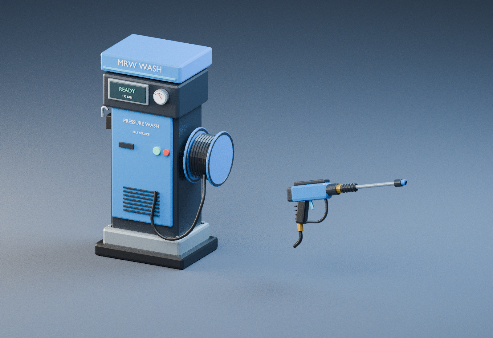

# MRW Carwash 3.0.0-rc.1

Ruční tlakové mytí pro FiveM s vlastními 3D modely a integrací **ox_inventory,
ox_target a ox_lib**. Tato verze je kandidát k hernímu ověření, nikoli tvrzení
o bezchybnosti nebo dokončené certifikaci pro prodej.

Hráč u stojanu vyzvedne pistoli přes target nebo použije inventářový předmět.
Po potvrzení zaplatí poplatek a chodí kolem auta s pistolí v ruce. Držením tlačítka
myši odstraňuje GTA špínu. Šampon zrychlí čištění; pistole se opotřebovává a zásoba
vody ubývá. Vybavení zůstává vlastnictvím hráče i po vrácení vizuální pistole.

- Vlastní stojan s manometrem, panelem, držákem a navijákem; vlastní pistole s tryskou.
- Serverové rezervace, omezená kapacita stojanů, platby až po vytvoření pistole.
- Jedno potvrzení může účtovat nejvýše jednou; neúspěšné vytvoření modelu je bez poplatku.
- Vybavení a šampon v ox_inventory, životnost a blokace přesunu aktivní pistole.
- ox_lib menu, průběh vyzvednutí, oznámení, stavový panel a přenastavitelné klávesy.
- Čas, dosah hadice a vody, kontrola entity a routing bucketu, omezení frekvence eventů.
- Úklid při smrti, odpojení, ztrátě vybavení, výpadku heartbeatů a restartu resource.
- České a anglické texty, inventářové ikony, serverové exporty a otevřený platební adaptér.

## Začínáme

1. Přečti [instalaci](docs/INSTALLATION.md), zejména definice inventářových předmětů a pořadí startu.
2. Do serveru vlož složku [mrw_carwash](mrw_carwash), která obsahuje `fxmanifest.lua`.
3. Uprav [config.lua](mrw_carwash/config.lua) a otestuj [herní scénáře](docs/TESTING.md).

Další dokumentace:

- [Nastavení a ovládání](docs/CONFIGURATION.md)
- [Architektura, API a hranice ochrany](docs/DEVELOPMENT.md)
- [Příprava vydání a prodeje](docs/RELEASE.md)
- [Změny oproti původnímu resource](CHANGELOG.md)
- [Modely a jejich přestavění](assets/README.md)

## Co je ověřeno a co ne

Automatické kontroly ověřují serverové transakce, ochranné podmínky, adaptéry
plateb, životní cyklus klienta a hranice nastavení s náhradami FiveM/ox API.
Samostatný převodník vytvořil a znovu načetl herní modely, LODy, vložené textury,
kolizi stojanu a obě archetypové definice.

**FXServer, skutečné ox resources, GTA klient, síťová synchronizace, animace,
zarovnání v ruce a výkon na živém serveru zde nebyly otestované.** Povinné scénáře
před ostrým nasazením jsou v dokumentaci testování. Automatické kontroly nejsou
zárukou bezchybnosti.

Čištění používá standardní GTA špínu rovnoměrně na celém vozidle. Neobsahuje vlastní
vrstvy nečistot smývané po jednotlivých místech jako specializované placené systémy.
Šampon je herní bonus s vizuálně světlejším proudem; nevytváří přetrvávající vrstvu
pěny na karoserii. Hadice na stojanu je pevný model, ne simulovaná hadice ke hráči.
17Movement není závislostí a žádné jeho modely ani kód nebyly použity.
