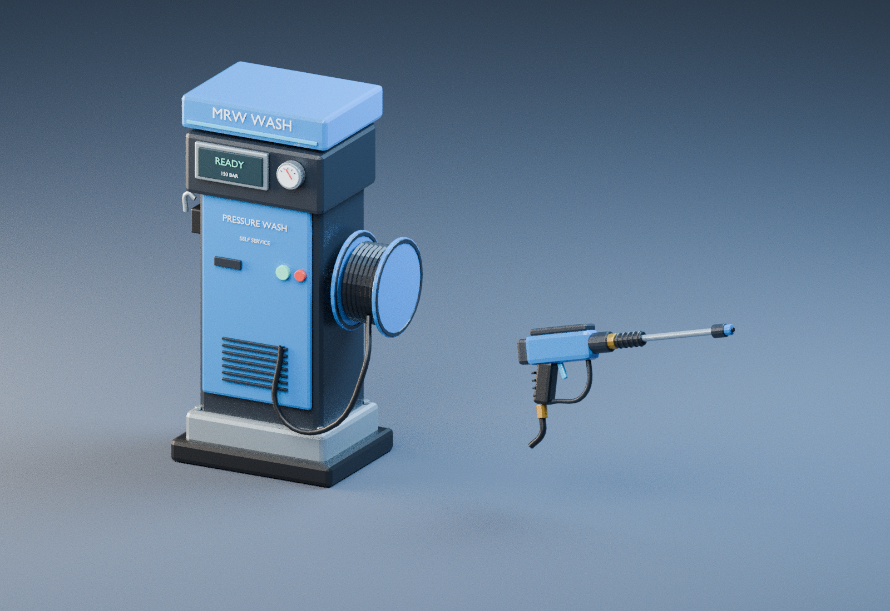

# Original MRW pressure-washer props



This is a render of the supplied original geometry, not a game screenshot.
The gun is enlarged 1.4× for the product sheet. No geometry, textures, branding
or other assets were extracted from GTA or the linked 17Movement product.

## Delivered assets

- `../mrw_carwash/stream/mrw_pressure_stand.ydr`: 1.785 m tall self-service cabinet,
  pressure gauge, display, buttons, service hatch, gun holster, hose reel and fixed coiled hose.
- `../mrw_carwash/stream/mrw_pressure_gun.ydr`: pressure gun, trigger/guard, grip,
  lance, nozzle and inlet connector. Origin is at the palm; barrel faces local +Y.
  Nozzle exit: `(0.0, 0.745, 0.078)` metres in model space.
- `../mrw_carwash/stream/mrw_carwash_props.ytyp`: two archetype definitions.
- `source/mrw_carwash_props.blend`: editable Blender source with game materials and LOD meshes.
- `source/build_models.py`: reproducible geometry, texture, LOD, collision and render generator.
- `source/render_inventory_icons.py`: renders the original transparent gun and shampoo inventory icons.
- `export/`: editable CodeWalker XML and original DDS inputs.

The stand has a simplified embedded box collision. The hand prop is intentionally
non-colliding at runtime. Both have high, medium and low LODs and embedded 8×8 BC1 colour
textures with complete mip chains, so no external texture dictionary is required.
The fixed coiled hose is part of the stand mesh. There is no simulated hose
connecting the player's moving gun to the stand.

Triangle counts: stand 12,236 high / 4,282 medium and low; gun 4,132 high / 1,446 medium and low.
The generated binaries target GTA V Legacy (Gen8).

## Rebuild (optional; not needed to run the resource)

Tested tools:

- Blender 4.3.2.
- Sollumz commit `e6278bc441289ecaf3e034755f730b729a48e035` (2.9 development).
- `szio==1.4.0.dev2`; upstream wheel SHA256:
  `6508f3692be8ea4d7954782c9ebb73391df613632b02d8549314e658a9392eb2`.
- .NET SDK 8.0.426.
- Unmodified CodeWalker.Core commit `485d56bec00262ed7fa472261cce7bbc6202b96e`.

These dependencies are not vendored into this repository. They retain their own
upstream licenses. Blender runs the generator with Sollumz and szio; CodeWalker.Core
compiles the XML into native resources. A Windows-only plugin is not required.

In this cloud, tool checkouts live under `/workspace/.carwash-tools`. Elsewhere set
`MRW_ASSET_TOOLS` to a directory containing the `Sollumz` checkout and `python/`
with szio installed. With those prerequisites, run from the repository root:

```bash
blender -b --factory-startup -t 4 --python-exit-code 1 --python assets/source/build_models.py
dotnet build assets/tools/Converter.csproj -c Release -p:CodeWalkerRoot=/path/to/CodeWalker
dotnet assets/tools/bin/Release/net8.0/Converter.dll assets/export/mrw_pressure_stand.ydr.xml assets/export/mrw_pressure_gun.ydr.xml assets/export/mrw_carwash_props.ytyp.xml
cp assets/export/mrw_pressure_stand.ydr assets/export/mrw_pressure_gun.ydr assets/export/mrw_carwash_props.ytyp mrw_carwash/stream/
```

The converter rejects missing meshes, LODs, pixel data, mip levels or stand
collision, then reopens each generated binary. It can also validate delivered
binaries directly by passing the three files under `mrw_carwash/stream/`.

## Runtime validation still required

Binary round-trip validation is complete. FiveM has not been run here. Check
streaming, lighting, stand collision/targeting and hand alignment in-game.
`gunOffset` and `gunRotation` remain configurable because animation/skeleton
alignment cannot be validated by an offline model exporter.
