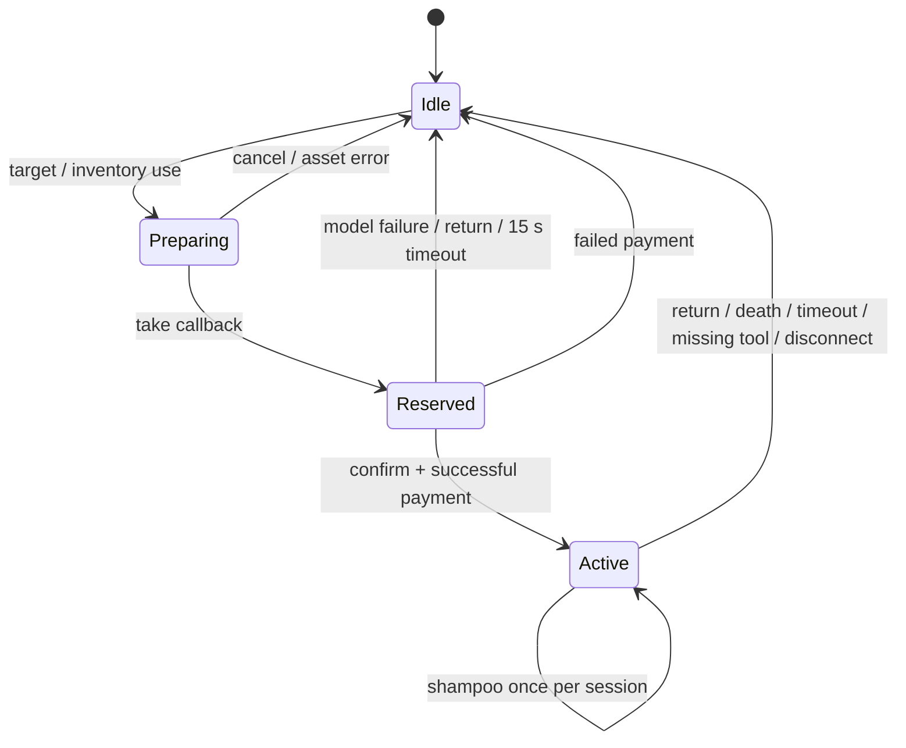

# Architektura a integrace

## Struktura

- `config.lua`: editovatelné nastavení.
- `shared/core.lua`: validace konfigurace, čísel a monotónní výpočet špíny.
- `server/bridge.lua`: inventář a volitelné účtové platby.
- `server/main.lua`: rezervace, aktivace, zásahy, limity, synchronizace a úklid.
- `client.lua`: ox_target, ox_lib, držený prop, raycasty, efekty a aplikace špíny.
- `locales/`: české a anglické texty.
- `stream/`: herní modely s vloženými texturami a registrace archetypů.

## Průběh relace



Klient nejdříve načte model a animaci a nabídne zrušitelný progress. Server potom
zarezervuje kapacitu. Až klient vytvoří lokální pistoli, potvrdí rezervaci;
server strhne cenu a nastaví aktivní relaci. Opakované potvrzení stejné aktivované
relace nic dalšího nestrhne. Callbacky pro rezervaci a potvrzení nemají síťové
yieldy uvnitř kritické sekce. Serverové adaptéry musí toto pravidlo zachovat.

Klient posílá heartbeat přibližně každou sekundu. Bez něj server po 15 s uvolní
relaci. To není důkaz fyzického držení objektu; oprávnění plyne ze serverové relace,
inventáře a serverových poloh.

## Serverové API

```lua
local session = exports.mrw_carwash:GetSession(playerId)
-- nil nebo nová kopie {id, station, water, foam, seconds, confirmed, price}
exports.mrw_carwash:EndSession(playerId)
```

`station` je index pole `Config.locations`, nikoli textové `id`. Tyto exporty jsou
určeny jiným serverovým resources. Neposkytují klientovi administrátorský event.

Interní callbacky ox_lib: `mrw_carwash:take`, `mrw_carwash:confirm`,
`mrw_carwash:foam`. Interní klientské exporty: `mrw_carwash.useWasher` pro
ox_inventory. Interní síťové eventy nejsou stabilní veřejné API pro obcházení
inventáře nebo plateb. Původní volně přístupné eventy automatické myčky neexistují.

## Špína a síť

Klient provede kamerový raycast a druhý od trysky k cíli. Server nepřijímá hráčem
zvolený úbytek špíny, cenu, čas, spotřebu ani životnost. Ověří relaci, item,
čas, vzdálenosti, routing bucket, síťovou entitu, typ vozidla a frekvenci.
Neplatné souřadnice včetně NaN, nekonečen a číselných řetězců odmítne.

Vlastník vozidla aplikuje standardní GTA špínu z `mrw_carwash:dirt`. Revize zabrání
opakovanému vynucování stejné hodnoty, takže vozidlo může znovu špinit. Stav se po
10 s neaktivity uklidí. Při změně síťového vlastníka jej převezme nový vlastník.
Žádné cizí state bag klíče se nemažou. Jiné dirt systémy mohou nativní hodnotu
přepisovat; neexistuje předstíraná kompatibilita s jejich neveřejnými API.

Pistole jsou lokální objekty, nikoli nové síťové entity. Ostatní klienti vytvoří
lokální kopii u hráče na základě replikovaných stavů `mrw_carwash:equipped` a
`mrw_carwash:station`; odstraní ji po odstreamování nebo ukončení. Klient k pistoli
připojí herní lano od koncovky u příslušného stojanu. Jeho délka průběžně sleduje
vzdálenost a ponechává rezervu nastavenou v configu. Příznaky jsou pouze vizuální
pomůcky, nikoli bezpečnostní oprávnění; vlastník player state může kosmetiku ovlivnit.
Částice nejsou navíc síťované: server distribuuje jen ověřený zásah hráčům poblíž
ve stejném bucketu. To brání zdvojení stejných částic síťováním i eventem.

## Hranice ochrany a výkonu

- Server nemá stejný přesný raycast jako herní klient. Kontrola zásahu je na klientu,
  server ověřuje geometrickou věrohodnost. Úprava klienta může obejít lokální
  překážky uvnitř serverem povoleného dosahu. Nejde o univerzální anti-cheat.
- lib/ox_inventory zajišťují vlastní autorizaci inventáře. Hook blokuje standardní
  přesuny aktivního slotu; jiný serverový resource může item změnit přímo. Pak se
  relace při dalším zásahu nebo pravidelné kontrole ukončí.
- Neplatné požadavky nezískávají platbu ani oprávnění. Herní entity mohou i přesto
  obecně upravovat modifikovaní vlastníci; tento resource nemůže zabezpečit celý GTA engine.
- Idle smyčky používají čekání 250–1000 ms, vykreslení běží po snímcích jen při
  aktivitě. Raycast má limit čekání 100 ms, efekty se evidují v jedné tabulce.
- Při zásahu se hledají poblíž stojící hráči. Složitost distribuce je úměrná počtu
  hráčů krát počtu aktivních mytí. Výkon na 100+ hráčích nebyl benchmarkován.
- Kolize, animace, audio, ovladače a výměna vlastníka vyžadují herní test.
  Vlastní zvukové soubory ani ovládání gamepadem zde nejsou dodané.

## Přizpůsobení

Pro jinou ekonomiku uprav pouze serverový adaptér a přidej odpovídající testy.
Nepřidávej klientovi možnost posílat cenu nebo výši čištění. Případná vlastní
textura špíny potřebuje samostatnou implementaci a doložené API, nikoli přejmenování
nativního `SetVehicleDirtLevel`.
